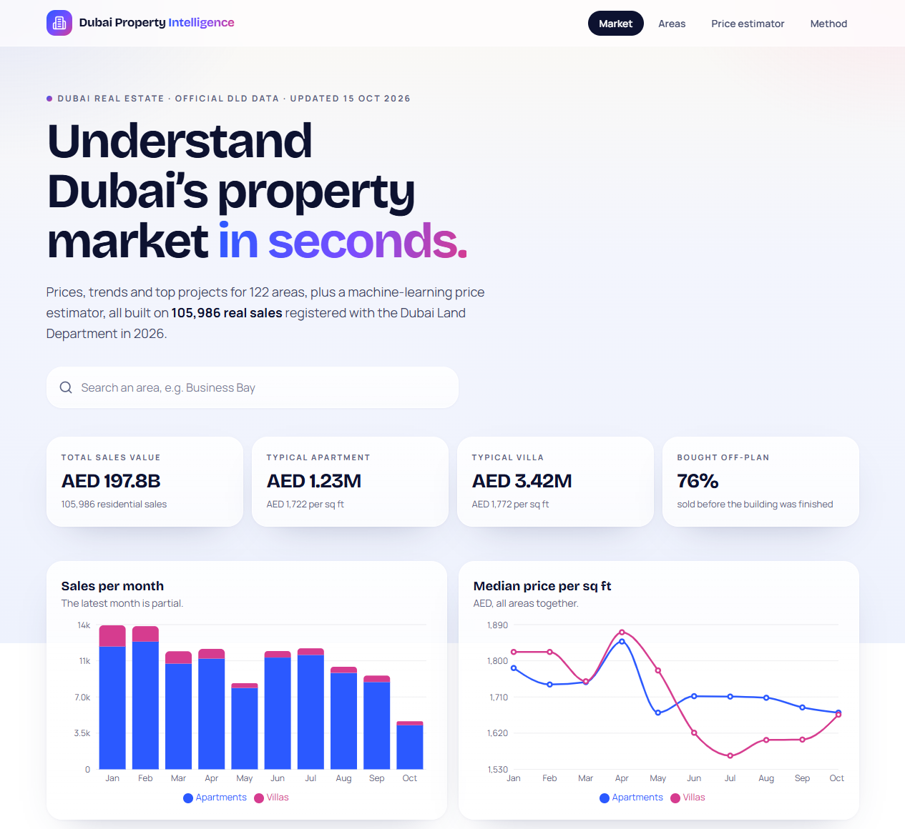
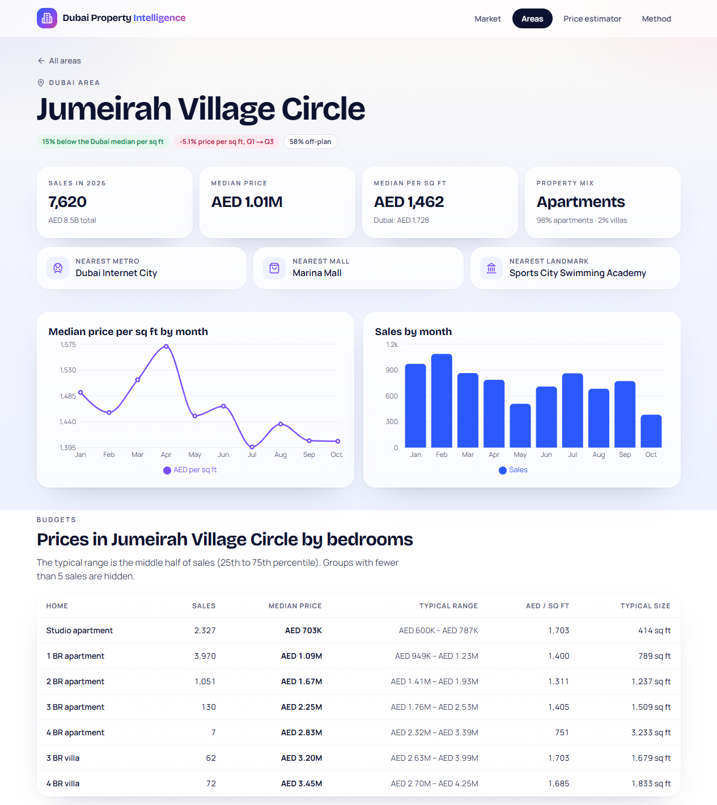
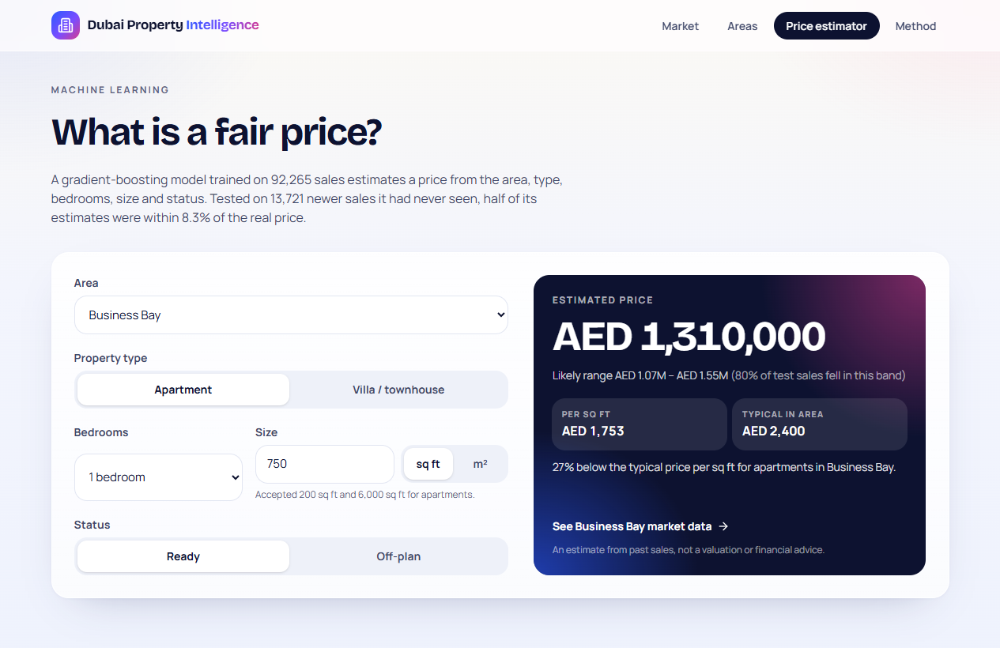

# Dubai Property Intelligence 🏙️

A web platform for understanding Dubai's residential property market, built on **official Dubai Land Department (DLD) data**: market dashboard, a page for every area, and a machine-learning price estimator.

**🔗 Live:** https://dubai-property-iq.vercel.app
**👤 Portfolio:** https://priyanshu-zihowa.vercel.app



> This is a **long-term project**. It started as a single-page [price estimator](https://github.com/hellopanda292/dubai-property-price-estimator) and is growing into a full platform. See the [roadmap](#roadmap).

---

## What it does today

| | |
|---|---|
| **Market dashboard** | total value, typical apartment/villa prices, off-plan share, monthly sales and price per sq ft |
| **Rankings** | busiest, most expensive, most affordable and fastest-rising areas |
| **122 area pages** | sales, median prices, price per sq ft vs the Dubai median, trend, prices by bedrooms with a typical range, most-sold projects, nearest metro, mall and landmark |
| **Area comparison** | sortable, filterable table of every area |
| **Market insights** | five questions answered like-for-like with fixed-effects regressions: is the market really falling, the off-plan premium, studio vs 1-bed price per sq ft, the size discount, and which projects sell above or below similar homes |
| **Price estimator** | gradient-boosting model: area, type, bedrooms, size, ready/off-plan → price with a likely range |
| **Method page** | data source, every cleaning step with row counts, model accuracy and limitations |



---

## Numbers

* **105,986** residential sales (1 Jan – 15 Oct 2026) after cleaning 129,748 raw transactions, worth **AED 197.8 billion**.
* Price model tested on the **two most recent months** (13,721 sales it never saw):

| Method | Median error | Within 10% | Within 20% |
|---|---|---|---|
| Baseline: area median × size | 11.2% | 46% | 71% |
| **Gradient boosting** | **8.3%** | **57%** | **83%** |



---

## Architecture

```
DLD CSVs (data/raw, not committed)
   │
   ▼
pipeline/clean.py ──► pipeline/build.py ──► src/data/generated/*.json   (market, areas, meta)
   (cleaning rules,      (statistics,      └► public/model.json          (400 exported trees)
    unit-tested)          model training,
                          exact-export check)
   │
   ▼
Next.js 15 (App Router, TypeScript, Tailwind) ── 130 pages pre-rendered at build time ── Vercel
```

* **Insights (`pipeline/insights.py`):** fixed-effects regressions (one effect per area × type × bedrooms) via the within transformation, unit-tested against a full dummy-variable regression; project scores use out-of-sample predictions from GroupKFold so a project never trains its own prediction.
* **Static-first:** every area page is generated at build time (`generateStaticParams`), so pages load instantly and hosting is free.
* **The model runs in the browser:** the scikit-learn trees are exported to JSON and walked in TypeScript. The pipeline **asserts** the exported trees match scikit-learn exactly before writing the file.
* **Honest testing:** time-based split (train on earlier months, test on the latest two), always compared to a simple baseline.

## Data cleaning

| Step | Rows |
|---|---|
| All sales transactions | 129,748 |
| Residential flats and villas | 111,030 |
| Real sale procedures (no lease-to-own or bulk developer registrations) | 107,807 |
| Bedrooms known | 107,778 |
| Realistic size and price | 107,058 |
| Without extreme price per sq ft (0.5% tails) | **105,986** |

DLD files villas under property type *Building*, mixes `BUSINESS BAY` and `Business Bay`, and writes some project names in capitals; the pipeline normalises all of these (see `pipeline/test_clean.py`).

---

## Roadmap

- [x] **Phase 1:** market dashboard, 122 area pages, comparison table, price estimator, method page
- [x] **Insights:** like-for-like price index, off-plan premium, bedroom and size effects, project value scores (cross-validated by project)
- [ ] **Phase 2:** rental data (DLD rent contracts) → **rental yield** per area and bedroom type
- [ ] **Phase 3:** **AI assistant**: ask in plain English (“2 bedroom under AED 1.5M near a metro”) and get answers from the data, using an LLM with tool calling
- [ ] **Phase 4:** map of areas, Arabic language (right-to-left)
- [ ] Later: automatic monthly data refresh, more features in the model, price alerts

---

## Run it yourself

1. Download the **Transactions** CSV (Sales) from the [DLD Real Estate Data page](https://dubailand.gov.ae/en/open-data/real-estate-data/) into `data/raw/`.
2. Build the data and run the tests:

```bash
pip install pandas numpy scikit-learn
```

```bash
python pipeline/build.py
```

```bash
python -m unittest discover -s pipeline
```

3. Run the website:

```bash
npm install
```

```bash
npm run dev
```

## Tech
Python · pandas · scikit-learn · Next.js 15 · React 19 · TypeScript · Tailwind CSS 4 · Recharts · Vercel

## Credits
* Data: **Dubai Land Department**, [Real Estate Data](https://dubailand.gov.ae/en/open-data/real-estate-data/) (open data). An independent student project, not affiliated with DLD. Figures are statistics of past sales, not valuations or financial advice.
* Built by **Priyanshu Zihowa**, with Claude Code as a coding assistant.

## License
MIT (code). The underlying data belongs to the Dubai Land Department.
